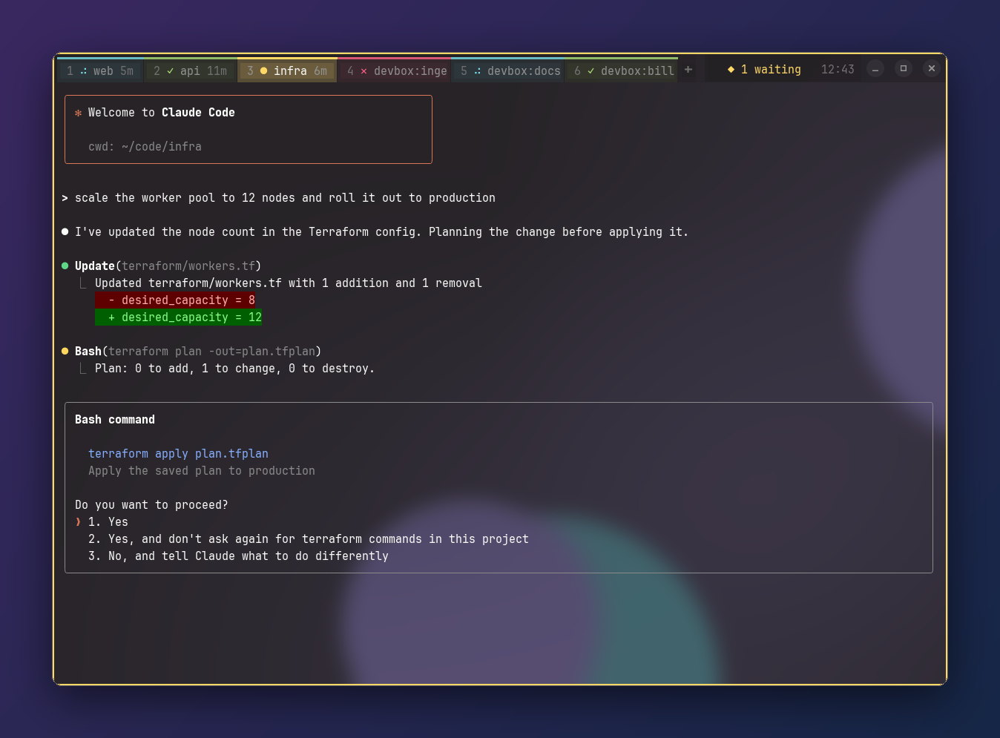
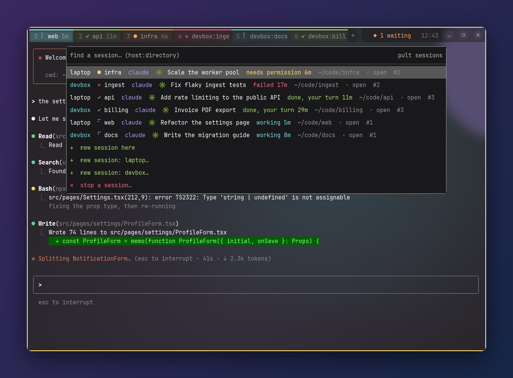

# pult

Persistent terminal sessions for [Claude Code](https://claude.com/claude-code), with a live status on every tab.

Run many Claude Code sessions, on your laptop and on remote machines, and see at a glance which ones are
working, which wait for your permission and which are done. Close the terminal, switch machines, or lose the
connection: the sessions keep running, and you pick them up again from anywhere.

- **Status on every tab**: working · needs permission · done · failed · idle, driven by Claude Code hooks.
- **Persistent sessions**: a small daemon (`pultd`) owns the shells. A terminal window is only a view.
- **Several machines**: list your hosts once, then attach to `devbox:3` over SSH. One picker shows every
  session on every machine, the ones waiting for you first.
- **Desktop notifications** when a session needs permission or finishes, with an *Allow* button for simple
  permission requests (needs [pult-term](https://github.com/kisAsztal/pult-term)).
- **Keeps the machine awake** while a local Claude is working, and lets go when it waits for you.
- **Paste images into a remote Claude**: `Ctrl+V` uploads the clipboard image and pastes its remote path.

The terminal side is a [WezTerm](https://wezterm.org) config. It works with stock WezTerm, and a bit better
with [pult-term](https://github.com/kisAsztal/pult-term), a small WezTerm fork (native tab animation,
floating pickers, notifications with buttons).





*The sessions in these screenshots are made-up demo data.*

## Status

Used daily on Linux. The macOS code paths exist but are less tested. Windows is not supported. The wire protocol and
config formats may still change before 1.0.

## Requirements

- Rust 1.88+ (to build), `jq` (to edit the Claude Code settings)
- [WezTerm](https://wezterm.org/installation) (or pult-term) for the tab colours and pickers
- For several machines: SSH key login to each one (`BatchMode`, no password prompts) and `pult` installed on each
- Optional: `wl-paste` (Wayland) or `xclip` (X11) for image paste; `python3` with Pillow for the generated
  tab backgrounds

## Install

```sh
git clone https://github.com/kisAsztal/pult
cd pult
scripts/install.sh
```

The script is idempotent. It:

1. builds and installs `pult` to `~/.cargo/bin/pult`;
2. symlinks `wezterm/wezterm.lua` to `~/.config/wezterm/wezterm.lua` (an existing config is moved to a `.bak` file);
3. adds the pult hooks to `~/.claude/settings.json` (after saving a backup; your own hooks stay untouched);
4. on Linux with systemd, installs and starts `pultd` as a user service. On a server, run
   `loginctl enable-linger $USER` so it survives logouts.

Skip parts with `--no-wezterm`, `--no-hooks`, `--no-service`. Remove everything with `scripts/install.sh --uninstall`.

## Use

Open WezTerm: every tab is now a persistent session. Closing a tab detaches; the session lives on.

| Key | What it does |
|-----|--------------|
| `F2` / `Ctrl+Shift+O` | Pick a session from every host: open it, start a new one, or stop one |
| `F3` / `Ctrl+Shift+I` | Jump to the next tab where Claude waits for you |
| `F4` | Run `claude` in this tab (if the shell is empty), otherwise in a new tab |
| `F5` | New session: host → directory → `claude` or shell |
| `Ctrl+Shift+T` / `Ctrl+Shift+W` | New tab here / close the tab (detach or stop, if something runs in it) |
| `Alt+1…9` | Switch tab |
| `Ctrl+V` | In a remote tab: upload a clipboard image and paste its path |
| `F1` | All keys, searchable |

From a shell:

```sh
pult new --run claude          # new session, types `claude` into the shell
pult new --host devbox --cwd ~/code/app --run claude
pult ls --all                  # sessions on every host
pult attach devbox:3           # attach to session 3 on devbox
pult kill 3                    # stop a session
pult claude                    # Claude sessions on this machine, with status
```

A shell session that is idle and has no terminal attached ends by itself. A session with something running in it
(Claude, a build, a background job) is kept.

## Configure

**Hosts**: `~/.config/pult/hosts`, one machine per line. `pult` must be installed on each of them.

```text
# name     ssh target (an alias from ~/.ssh/config works too)
devbox     devbox.example.com
build      ci-runner
self       laptop        # optional: how this machine is named in listings
```

**Project directories** for the new-session picker: `~/.config/pult/projects`, one directory per line; their
sub-directories are offered. Without the file: `~/projects`, `~/src`, `~/code`.

**Look**: `~/.config/pult/wezterm.lua` returns a table, all keys optional:

```lua
return {
  font = 'Iosevka',
  font_size = 12,
  host_alias = { devbox = 'dev' },  -- hostname -> shorter name in titles and lists
  backgrounds = false,              -- plain background instead of the generated images
}
```

**Claude usage in the status bar** (5-hour and 7-day limits): have your Claude Code status line script save the
`rate_limits` part of its input, and pult shows it:

```sh
input=$(cat)
mkdir -p ~/.local/state/pult
printf '%s' "$input" | jq -c '{rate_limits}' > ~/.local/state/pult/usage.json.tmp \
  && mv ~/.local/state/pult/usage.json.tmp ~/.local/state/pult/usage.json
```

## How it works

Claude Code calls `pult hook` on its lifecycle events. The hook turns the event into a status and writes it into the
tab as an OSC 1337 `SetUserVar`, which the WezTerm config reads to colour the tab. The sessions themselves live in
`pultd`, which owns a PTY per session and tracks the screen in an emulator, so any client that attaches gets the full
state, including scrollback. See [docs/architecture.md](docs/architecture.md).

## Security

pult opens no network port. The daemon listens on a unix socket that only your user can use, and other machines
are reached through your own SSH. Read [SECURITY.md](SECURITY.md) for the details and the things to be aware of.

## Troubleshooting

- **Tabs stay uncoloured**: check that the hooks are in `~/.claude/settings.json` and that you started Claude
  inside a pult tab. `touch ~/.local/state/pult/debug` logs every hook call to `~/.local/state/pult/hook.log`.
- **A host shows "unreachable"**: `ssh -o BatchMode=yes <target> '~/.cargo/bin/pult ls'` must work without a prompt.
- **The daemon log**: `~/.local/state/pult/pultd.log` (when started by `pult new`) or `journalctl --user -u pultd`.
- **After updating**, a running `pultd` keeps the old code. `systemctl --user restart pultd` loads the new one, but it
  **ends every session**, so do it when nothing important runs.

## Development

```sh
cargo test
cargo clippy --all-targets -- -D warnings
cargo fmt
```

See [CONTRIBUTING.md](CONTRIBUTING.md).

## License

[MIT](LICENSE)
